<p align="center">
  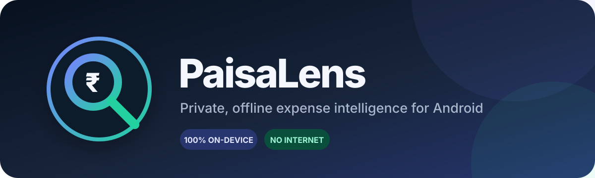
</p>

<p align="center">
  <a href="https://github.com/RohitSiga95/PaisaLens/releases/download/v1.8.9-ui-refresh.1/PaisaLens-v1.8.9-debug.apk"></a>
  
  
  
  
</p>

<p align="center">
  A private Android expense tracker for Indian bank, credit-card, wallet, UPI, and utility bill alerts.<br>
  Your SMS and financial data are processed entirely on your phone.
</p>

<p align="center">
  <a href="https://github.com/RohitSiga95/PaisaLens/releases/download/v1.8.9-ui-refresh.1/PaisaLens-v1.8.9-debug.apk"><strong>Download the v1.8.9 UI refresh debug APK</strong></a>
  &nbsp;·&nbsp;
  <a href="#daily-balance-graphs">See balance graphs</a>
  &nbsp;·&nbsp;
  <a href="https://github.com/RohitSiga95/PaisaLens/releases/tag/v1.8.9-ui-refresh.1">View release notes</a>
  &nbsp;·&nbsp;
  <a href="PRIVACY.md">Privacy notice</a>
</p>

> [!IMPORTANT]
> The downloadable file is the current **debug APK** for direct installation and testing. Android may ask you to allow installation from your browser or file manager. Requires Android 8.0 (API 26) or newer.

## What's new in the v1.8.9 UI refresh

| | Update | Highlights |
|---|---|---|
| 📉 | **[Daily balance graphs](#daily-balance-graphs)** | Track bank balances and available card credit over 7, 30, or 90 days for individual accounts, cards, and merged groups. |
| 🏠 | **Responsive Home and Spending Lens** | Reorder, hide, or show Home sections, choose a density, and tap categories to see their transactions. Home adapts to wider screens with multiple columns. |
| 🔎 | **Smart Activity** | Group transactions by day, remove individual account filters, save views, and see merged SMS counts without adding extra ledger rows. |
| 🗓️ | **Unified bill timeline** | See utility bills, card statements, and other payments together. Expand a bill to set a reminder or mark it paid, and check the Paid tab for history. |
| ⚡ | **Faster SMS sync** | Normal sync checks new messages. **Settings → SMS analysis → Full rescan** still checks the whole inbox. |

### Daily balance graphs

Tap a bank or card tile on **Home**, or go to **Settings → Accounts & cards** and tap an entry's **Balance history**. Pick **7, 30, or 90 days**, then tap or drag the chart to inspect a day's value.

Bank accounts show **available balance**. Credit cards show **available credit**, not the statement amount. In a merged group, use **Combined balance** to see the total or select an individual account or card. The combined graph starts once every member has a saved reading.

An open graph refreshes when a new SMS with a supported balance or available-credit reading is synced. On days without a new reading, a dashed line carries the last known value forward.

<table>
  <tr>
    <th scope="col">Bank accounts</th>
    <th scope="col">Credit cards</th>
  </tr>
  <tr>
    <td align="center"><strong>Individual bank account</strong><br>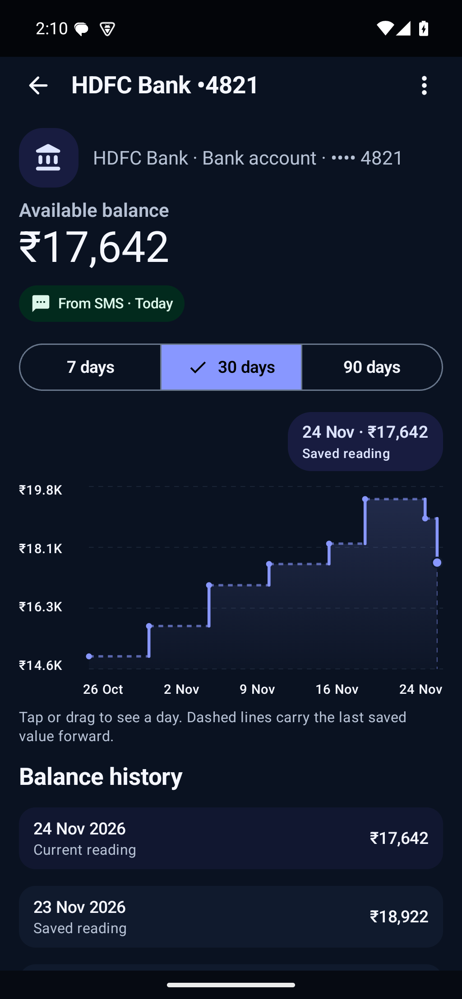</td>
    <td align="center"><strong>Individual credit card</strong><br></td>
  </tr>
  <tr>
    <td align="center"><strong>Merged bank accounts</strong><br>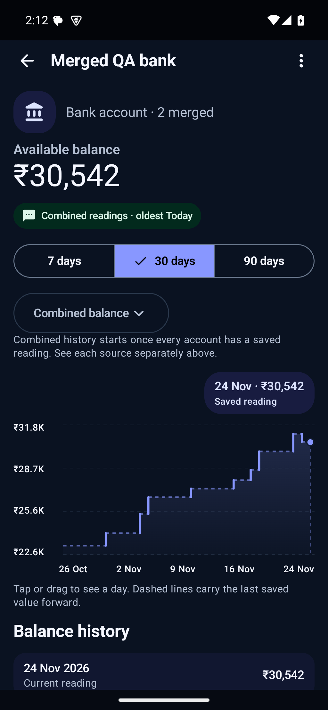</td>
    <td align="center"><strong>Merged credit cards</strong><br>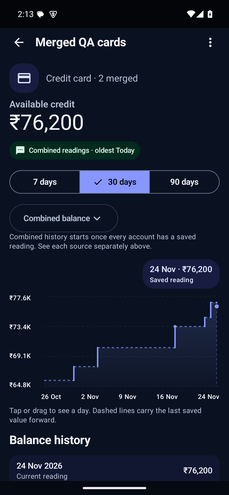</td>
  </tr>
</table>

<sub>Captured in the Android emulator with sample SMS and balances.</sub>

### Also in v1.8.9

| | Update | Highlights |
|---|---|---|
| 🧾 | **Utility bills from SMS** | Find supported electricity, broadband, and mobile postpaid bills in **Plan → Bills & dues**. See the amount and due date, review repeat notices together, and set a reminder. |
| 🏦 | **One balance per bank account** | Duplicate profiles from the same bank with the same last four digits use the latest SMS balance. Transaction and balance history are preserved. |
| ⚡ | **Android app shortcuts** | Press and hold the PaisaLens icon to add an expense, sync SMS, open Bills & dues, or open Reminders. |

<details>
<summary><strong>Earlier v1.8 updates</strong></summary>

| | Update | Highlights |
|---|---|---|
| 💳 | **Card payment matching** | Review matches from supported issuer SMS. Confirm partial payments to update the remaining balance. Confirm full payment to settle the statement and stop reminders for that cycle. |
| 🏠 | **Home daily check-in** | See spending since your last visit, bills due in the next seven days, and items to review. Tap each row to see the details. |
| 🔔 | **Test bill reminders** | See the next planned alert and its Android notification channel in reminder settings. Send a sample to check delivery. |
| 📝 | **Financial form scrolling** | Subscription, AutoPay, savings, split expense, and reminder editors keep drafts open while you scroll. The form fits above the keyboard and confirms before discarding edits. |
| ⏰ | **Custom bill-payment reminders & widget** | Create one-time or recurring reminders for detected credit-card statements and saved utility, EMI, subscription or other bills. Configure multiple advance alerts, local time and timezone, overdue repeats, snooze choices, skip-next, priority, quiet hours, a daily summary and private amount visibility; then keep upcoming bills visible in a responsive Android widget. |
| 🧹 | **Reliable duplicate-SMS cleanup** | Live receiver and inbox-rescan copies now consolidate into one Activity row with a `×N` source count. A resync repairs existing timestamp-offset copies while exact identity, backup, restore, and undo safeguards keep genuine repeat purchases separate. |
| 🏦 | **Account and card groups** | Merge two or more bank accounts—or two or more credit cards—under a custom name. Transactions keep their original source identity for future SMS matching while appearing together throughout the app. |
| 💡 | **Financial Pulse & richer Home** | See an explainable safe-to-spend estimate, balance freshness, a 14-day money timeline, budget pace, card health, and configurable Everyday, Budget, Debt, or Minimal layouts. |
| 🧭 | **Needs Your Attention & Weekly Review** | Turn stale balances, uncertain transactions, upcoming payments, goal pacing, and backup health into a short prioritized action list. |
| 🎯 | **Budgeting 2.0** | Plan calendar-month, payday, annual, or irregular budgets with rollover options, custom warning levels, and custom-category support. |
| 🧰 | **Advanced Activity & saved views** | Combine date, amount, type, source, institution, category, tag, duplicate, review, and multi-account filters, then save reusable private views. |
| 🚨 | **Private actionable alerts** | Opt into local reminders for dues, budget pressure, card utilisation, low forecast cash, and unsettled reimbursements with generic lock-screen text by default. |
| 👁️ | **One-tap privacy mode** | Hide monetary values across the app and widgets instantly, optionally start private, and ask Android to protect screenshots and Recents previews. |
| 🔐 | **Scheduled encrypted backups** | Create verified password-protected backups on a daily, weekly, or monthly schedule in a user-selected Android folder with safe retention. |
| 📡 | **Better SMS coverage and resync** | Pull down on any main screen to rescan, consolidate exact duplicate alerts with a source count, and review unsupported financial formats in the encrypted Coverage Centre. |
| 💳 | **Credit-card bills & colorful widgets** | Track current statement dues, paid history and per-card trends, plus add snapshot, category, due-bills, and card-bills widgets. |
| 👥 | **More flexible shared expenses** | Split by amount or percentage across named people, link reimbursements safely, and inspect shared-spend category statistics. |

</details>

<table>
  <tr>
    <td align="center"><strong>Custom Home</strong></td>
    <td align="center"><strong>Savings goals</strong></td>
    <td align="center"><strong>Subscriptions &amp; AutoPay</strong></td>
    <td align="center"><strong>Private digest</strong></td>
  </tr>
  <tr>
    <td>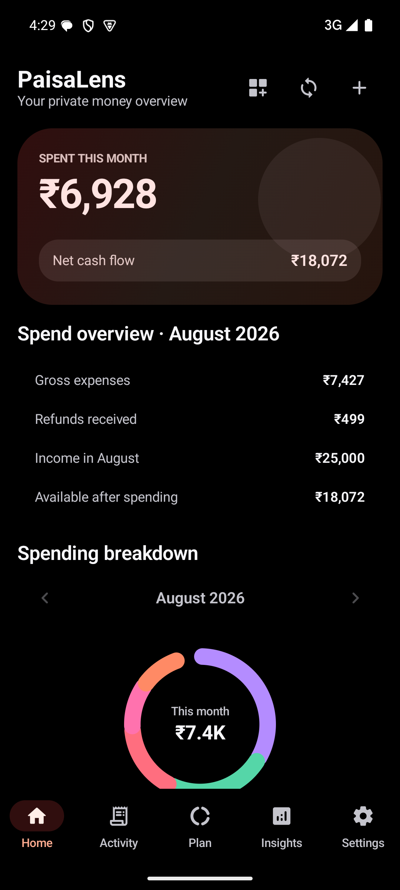</td>
    <td>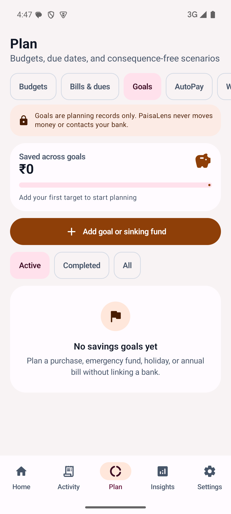</td>
    <td>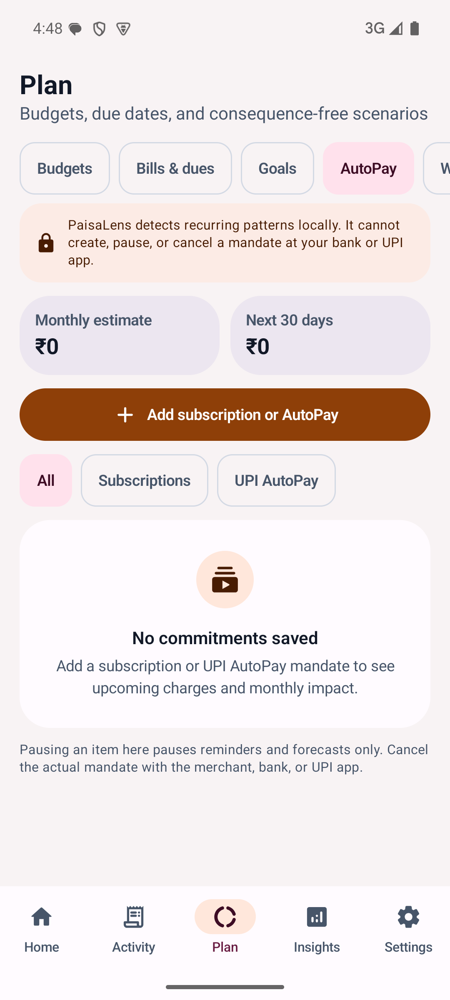</td>
    <td>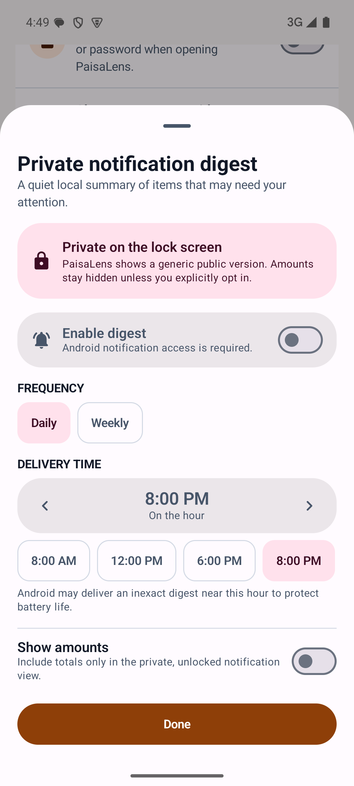</td>
  </tr>
</table>

<p align="center">
  <a href="https://github.com/RohitSiga95/PaisaLens/releases/tag/v1.8.9-ui-refresh.1"><strong>Read the v1.8.9 UI refresh release notes →</strong></a>
</p>

## See PaisaLens in action

<table>
  <tr>
    <td align="center"><strong>Dashboard &amp; merchant grouping</strong></td>
    <td align="center"><strong>Searchable activity &amp; notes</strong></td>
    <td align="center"><strong>Private Excel export</strong></td>
  </tr>
  <tr>
    <td>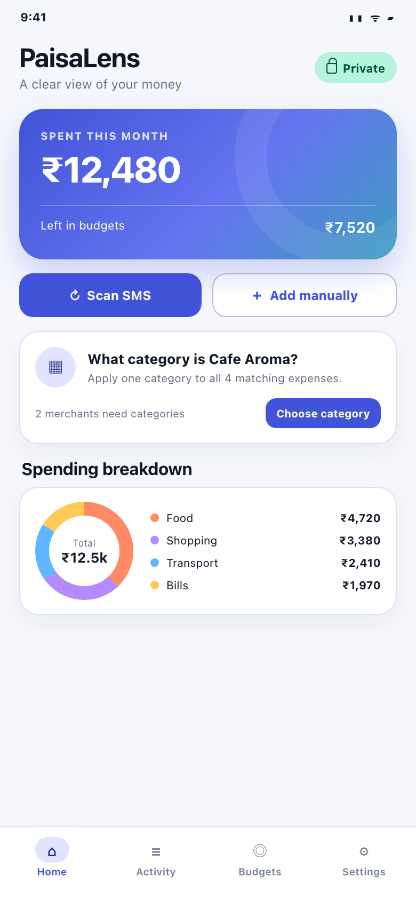</td>
    <td>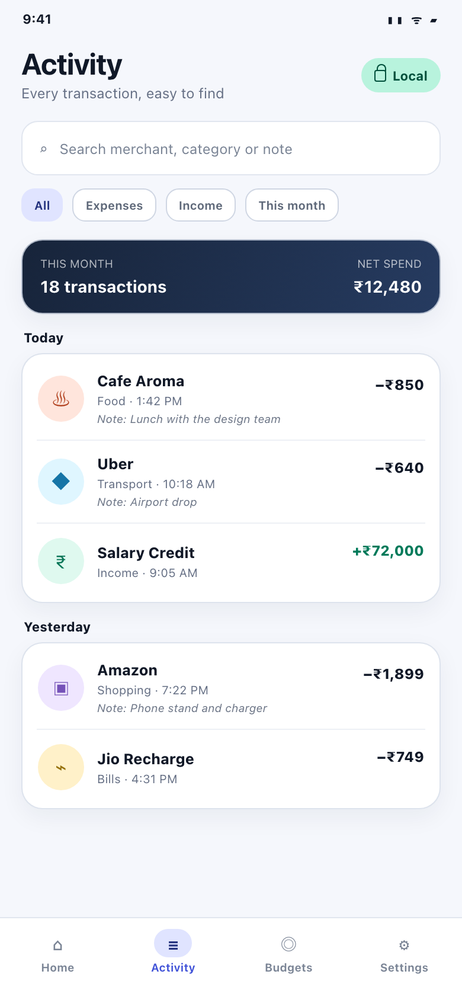</td>
    <td>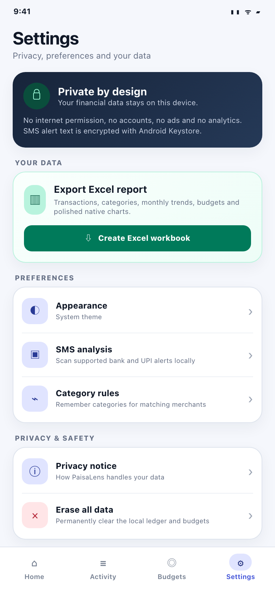</td>
  </tr>
</table>

<sub>Preview screens mirror the current Compose interface; the example transactions and totals are sample data.</sub>

## Your spending, made understandable

| | Feature | What it does |
|---|---|---|
| 🔎 | **Local SMS detection** | Pull down on any main screen to sync new messages. To revisit the entire inbox after a restore or to apply new detection rules, use **Settings → SMS analysis → Full rescan**. |
| ⚡ | **Android app shortcuts** | Press and hold the PaisaLens icon for **Add expense**, **Sync SMS**, **Bills & dues**, or **Reminders**. On supported launchers, you can also drag a shortcut onto your home screen. |
| 🏷️ | **Merchant category rules** | Groups matching merchants, shows their spending history and trend, asks you once for the category, updates their existing expenses and remembers the answer. |
| 📝 | **Expense notes** | Adds a specific note to a deducted transaction and shows it beneath the item in recent activity and search results. |
| 📊 | **Focused Home dashboard** | Moves month by month with arrow navigation and updates the spend summary, overview, category breakdown, daily chart, and expense list together. |
| 💡 | **Financial Pulse** | Turns fresh bank balances, bills, card dues, budgets, goals, expected income and a safety buffer into an explainable safe-to-spend figure, a 14-day timeline, budget pace and card-health snapshot. |
| 🧱 | **Customisable Home** | Shows, hides, and reorders dashboard modules, switches Compact or Comfortable density, chooses the hero metric, and offers Everyday, Budget, Debt and Minimal presets stored only on the device. |
| 🧭 | **Needs Your Attention & Weekly Review** | Prioritizes uncertain transactions, stale balances, upcoming bills, goal pacing and backup health, then turns them into direct, local actions. |
| 🧰 | **Advanced Activity filters & saved views** | Combines account, date, amount, source, bank/card, category, tag, duplicate and review filters; saves reusable local views and clears them with Erase all. |
| 🎯 | **Budgeting 2.0** | Supports calendar-month or payday periods, annual and irregular-event plans, positive/full rollover, custom warning thresholds, and custom categories. |
| 📗 | **Beautiful Excel export** | Creates a categorized, link-aware workbook with recorded and analysis amounts, trends, budgets, dashboard cards and native charts. |
| 🏦 | **Named accounts & cards** | Renames bank accounts and credit cards once, keeps that name across existing and future matching SMS, tags alerts from HDFC, IDFC, SBI, SIB and other recognized institutions, and supports multi-select bank/card filters in Activity. |
| 💳 | **Balances & available credit** | Combines duplicate bank profiles with the same bank and last four digits and shows the latest SMS balance once. A balance you enter after checking a UPI app is saved to history. |
| 🧾 | **Utility bills from SMS** | Finds the amount and due date on supported electricity, broadband, and mobile postpaid notices. Repeat notices for the same bill appear together in **Plan → Bills & dues**, where you can review the bill and set a reminder. |
| 🔁 | **Recurring payments** | Detects consistent weekly and monthly expenses and estimates the next due date. |
| 👥 | **Split expenses & reimbursements** | Splits by exact amount or percentage across named participants, tracks partial repayments, links incoming reimbursements without double-counting, and summarizes shared spending by category. |
| 🐷 | **Savings goals & sinking funds** | Tracks targets, money already saved, dated contributions, progress, remaining amount, and the monthly pace needed to reach an optional target date. |
| 🔄 | **Subscriptions & UPI AutoPay centre** | Manages recurring charges and mandate limits, pause/cancel states, accounts, due dates, and reviewed on-device suggestions without creating or changing a real bank or UPI mandate. |
| 🧩 | **Colorful categories & tags** | Uses meaningful category colors and icons, creates personal categories directly from any category picker, and adds searchable tags. |
| ✅ | **Review inbox** | Holds uncertain merchant or category matches for confirmation before they affect analytics. |
| 🔐 | **Encrypted backup, restore & scheduling** | Creates password-protected portable backups—including bill-reminder rules and defaults—verifies them before rotation, and can save them on a daily, weekly or monthly schedule to a user-selected Android folder. |
| ✍️ | **Manual entry & bill OCR** | Records an expense, income, refund, or transfer, or prefills the form from a photographed/uploaded bill using a bundled on-device OCR model. |
| 🎨 | **Theme Studio** | Customizes the full app and home-screen widget with Material, AMOLED pure black, or layered gradients; System/Light/Dark appearance; and 14 accessible color variations. |
| 🧹 | **Merchant cleanup** | Renames or merges inconsistent merchants and applies the cleanup rule to future SMS and statement imports. |
| 🏠 | **Colorful Android widgets** | Offers current-month snapshot, category breakdown, due-bills, credit-card-bills and bill-reminder agenda widgets, with privacy-aware amount hiding and responsive layouts. |
| 🔔 | **Private notification digest** | Optionally delivers a daily or weekly on-device summary; amounts are hidden by default and the lock-screen public version is always generic. |
| 🚨 | **Private actionable alerts** | Optionally checks once daily for urgent dues, budget pressure, high card use, low forecast cash and overdue reimbursements, with configurable thresholds, local-only evaluation and generic lock-screen text by default. |
| 👁️ | **One-tap privacy mode** | Hides monetary values throughout the open app and widgets from the Home eye button, supports a private-by-default preference, and can ask Android to block screenshots and Recents previews. |
| 🔒 | **App lock** | Uses Android's system fingerprint, face, PIN, pattern, or password prompt to protect the ledger. |
| 📥 | **Statement import** | Previews and imports common CSV and XLSX bank statements locally with duplicate protection. |
| 📈 | **Better analytics** | Adds six-month trends, projections, top merchants, category rankings, and exact-value summaries. |
| 📅 | **Calendar view** | Browses confirmed expenses day by day and opens the underlying transactions. |
| 🏦 | **EMI & loan tracker** | Calculates reducing-balance EMI, tracks paid installments, progress, and next due dates. |
| ✈️ | **Travel mode** | Stores original foreign amounts and converts them with an explicitly refreshed HTTPS reference rate. |
| ✨ | **On-device insights** | Detects possible duplicates, unusual charges, price increases, spending pace, and concentration without uploading data. |
| 📉 | **[Balance history](#daily-balance-graphs)** | Shows daily graphs for individual and merged bank accounts and cards, and updates them as new balance readings arrive. |
| 💳 | **Credit utilisation tracker** | Combines the real available credit with a detected or manually entered total limit, then highlights healthy, moderate, high, and critical usage. |
| 🗓️ | **Bills & due-date centre** | Brings manual reminders, locally detected recurring payments, card bills, subscriptions and loan EMIs into one overdue and upcoming timeline. |
| ⏰ | **Custom bill-payment reminders** | Adds one-time or recurring reminders to saved utility bills and detected credit-card statements, with multiple advance alerts, local time and timezone, snooze choices, overdue repeats, skip-next, priority, private amount controls, categories, colors, notes, search, grouped views, quiet hours and an optional daily summary. |
| 🔮 | **Cash-flow forecast** | Projects 30, 60, or 90 days from known bank balances, recent income/spending pace, scheduled bills, and EMIs, with assumptions shown beside the chart. |
| 🧮 | **Net-worth dashboard** | Combines known account balances, utilised card credit, amortised loan principal, and manually added assets or liabilities. |
| ⚙️ | **Smart category rules** | Applies prioritized merchant, amount, and account conditions to future expenses, with a preview and optional historical update. |
| 🧪 | **What-if simulator** | Compares baseline and scenario cash positions for income changes, flexible-spend reductions, and one-time purchases without changing real data. |
| 🧾 | **Monthly reconciliation** | Compares an account's confirmed activity with reviewed opening and closing balances, surfaces the exact difference, and saves a month as balanced or reconciled. |
| 🔗 | **Transaction linking** | Suggests likely transfers, card payments, refunds, reversals, and reimbursements by amount, date, account and flow, then prevents confirmed links from inflating dashboards, budgets, forecasts, the widget, or Excel analysis. |
| 🕵️ | **Credit-card statement auditor** | Audits reviewed CSV/XLSX statement rows against locally detected SMS transactions, separates purchases, fees, interest, GST, refunds and payments, and flags missing or duplicate charges. |
| 💳 | **Credit-card bill dashboard** | Reads supported statement alerts, suggests payments to review, tracks the remaining balance per card, keeps bill history, and shows per-card spending trends. |
| 📡 | **SMS Coverage Centre** | Keeps unsupported likely-financial alerts encrypted on-device for review, then lets the user add narrow literal sender-and-phrase rules without uploading message text. |
| 🧬 | **Duplicate-SMS consolidation** | Merges repeat copies of the same alert into one ledger row and displays the number of source messages on that activity item. |
| 🩺 | **Data Health Centre** | Brings review backlog, uncategorized spending, stale balances, reconciliation differences, unlinked transfers, scan freshness, and backup readiness into one private health check. |
| ↩️ | **Audit history & undo** | Records supported ledger, link, and reconciliation changes in an on-device history and safely reverses eligible batches. |
| 🛡️ | **Backup verification** | Opens an encrypted `.plbk` backup read-only to verify its password, authenticated contents, format, checksum, and protected record counts without restoring it. |

### Excel reports that are ready to explore

The workbook is generated entirely offline and saved only where you choose through Android's system file picker.

<p align="center">
  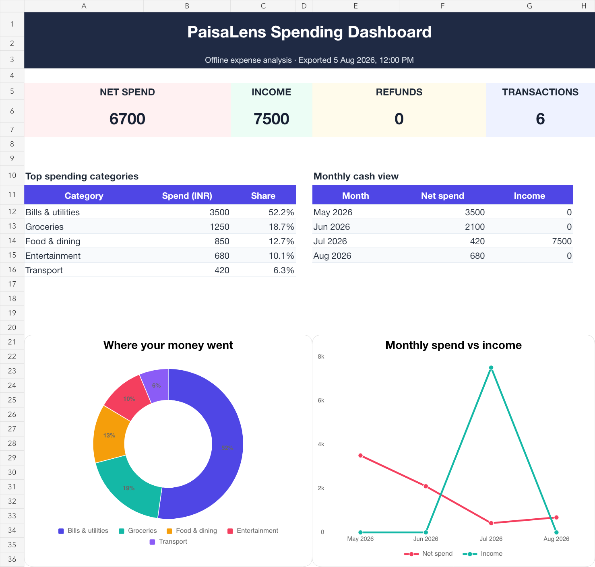
</p>

## Private by design

```text
SMS / statement  →  on-device parser  →  encrypted local ledger  →  dashboard / Excel export
          │                │                       │              ↘ encrypted manual backup
          └──── local statement audit             ├──── reconciliation / undo / health checks
                                                  ├──── optional private digest / actionable alerts / bill reminders
                                                  └──── scheduled encrypted backup to chosen folder
currency pair only  →  HTTPS reference-rate API  →  cached rate ↗
                                       ✕ no account
                                       ✕ no telemetry
                                       ✕ no financial-data upload
```

- No account, ads, third-party analytics, telemetry or cloud SDKs.
- `INTERNET` is used only after the user taps a Travel-mode rate refresh; the HTTPS request contains only the currency pair.
- SMS, receipt images and OCR, statements, transactions, balances, merchants, loans, categories, notes, tags, budgets, participant shares, savings goals, payment commitments, card-bill history, reminder rules, and insights stay on the device.
- Account refresh opens a prefilled system SMS composer; PaisaLens never sends an SMS automatically and requests no `SEND_SMS` permission.
- UPI balance check only opens the selected app's normal home screen. No PIN, account identifier or balance is returned to PaisaLens; the user chooses whether to type and save the displayed amount locally.
- Automatic cloud backup and device-transfer backup are disabled.
- Optional manual or scheduled backups are encrypted on-device with a user passphrase, exclude raw SMS text, are verified before completion, and are saved only in the file or folder the user chooses.
- SMS is read only after explicit permission and disclosure.
- OTPs, verification codes and payment requests are ignored; supported credit-card statement and due alerts are parsed only into bill totals and dates.
- Unsupported likely-financial alerts shown in SMS Coverage Centre are encrypted locally and are deliberately excluded from portable backups.
- Stored SMS alert text is encrypted with AES-GCM using a non-exportable Android Keystore key.
- Transactions, notes, account profiles, balance history, bills, net-worth items, custom categories, tags, smart rules, cleanup aliases, loans, reconciliation records, transaction links, expense splits, savings contributions, subscription/AutoPay records, audit events, and cached rates use app-private platform SQLite storage. Home preferences, Activity saved views, alert settings and repeat-suppression records use app-private preferences.
- **Erase all** clears the local PaisaLens ledger and organization data without changing the phone's SMS inbox or previously exported files.

Read the complete [plain-language privacy notice](PRIVACY.md).

## Download and install

1. Download **[PaisaLens-v1.8.9-debug.apk](https://github.com/RohitSiga95/PaisaLens/releases/download/v1.8.9-ui-refresh.1/PaisaLens-v1.8.9-debug.apk)** on your Android phone.
2. Open the downloaded file.
3. If Android prompts you, allow your browser or file manager to install unknown apps.
4. Choose **Install**, then open PaisaLens and review the SMS disclosure before granting access.

This APK is from the [v1.8.9 UI refresh release](https://github.com/RohitSiga95/PaisaLens/releases/tag/v1.8.9-ui-refresh.1). The app version stays at 1.8.9. The [original v1.8.9 release](https://github.com/RohitSiga95/PaisaLens/releases/tag/v1.8.9) and its [APK download](https://github.com/RohitSiga95/PaisaLens/releases/download/v1.8.9/PaisaLens-v1.8.9-debug.apk) are still available.

**APK SHA-256**

```text
64273bdcc7a34ae6ee01e20d129815f585b71dd9918e3d5218dad44faf46f7de
```

## Build it yourself

Requirements: JDK 17, Android SDK Platform 36 and Android SDK Build Tools 35 or newer.

```bash
./gradlew testDebugUnitTest lintDebug assembleDebug
```

The generated APK will be available at:

```text
app/build/outputs/apk/debug/app-debug.apk
```

Install it on a USB-connected Android device with:

```bash
adb install -r app/build/outputs/apk/debug/app-debug.apk
```

<details>
<summary><strong>Project structure</strong></summary>

```text
app/src/main/java/com/paisalens/app/
├── data/
│   ├── local/          # SQLite and preferences
│   ├── model/          # Transaction and budget models
│   ├── parser/         # Bank, card and UPI SMS parser
│   ├── importer/       # Local CSV/XLSX statement import
│   ├── network/        # Explicit HTTPS reference-rate refresh only
│   ├── backup/         # Password-protected portable backups
│   ├── export/         # Offline Excel workbook generation
│   └── repository/     # Local data coordination
├── security/           # Android Keystore AES-GCM
├── sms/                # Inbox scanner and incoming SMS receiver
├── widget/             # Privacy-aware Android home-screen widget collection
└── ui/                 # Compose theme, components and screens
```

</details>

## SMS permission and Play distribution

`READ_SMS` and `RECEIVE_SMS` are restricted Google Play permissions. SMS-based money management is listed as an eligible exception, but public Play distribution still requires a Permissions Declaration, prominent disclosure, consent, a privacy policy and Google Play review. A directly installed APK does not go through Play review, but PaisaLens intentionally keeps the runtime permission and disclosure.

[Read Google's SMS and Call Log permission policy](https://support.google.com/googleplay/android-developer/answer/10208820).

## Accuracy note

Banks and payment providers use many SMS formats. PaisaLens uses deterministic on-device rules and covers common Indian formats, but you should still verify detected transactions and recategorize them when needed. PaisaLens never initiates payments or accesses a bank account.

---

<p align="center">
  <strong>PaisaLens</strong> · Your money stays yours.
</p>
